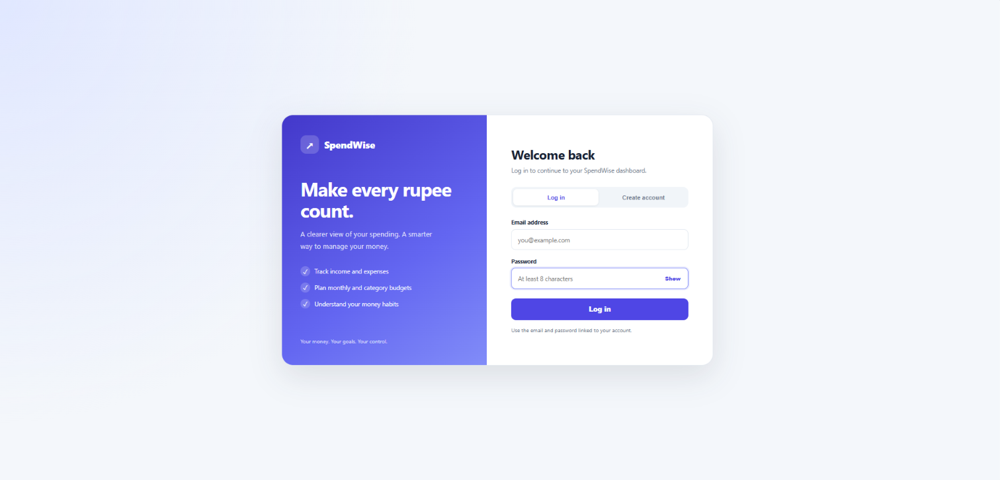
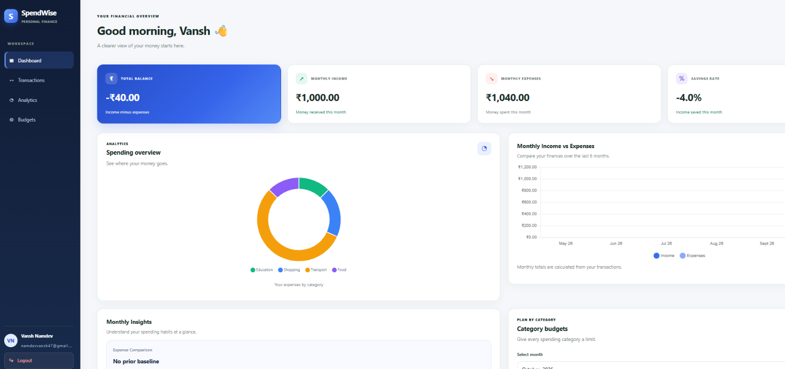
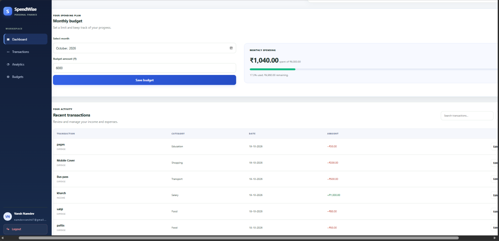

# SpendWise — Personal Expense Tracker

SpendWise is a full-stack personal expense tracking web application built to help users manage their income, expenses, and monthly budgets through a clean, responsive dashboard.

## Features

- **User Authentication** — Sign up, log in, and log out securely.
- **Transaction Management** — Add, view, update, and delete income and expense transactions.
- **Dashboard** — View financial summaries and spending trends.
- **Budget Management** — Set monthly budgets and category-wise budgets.
- **Visual Analytics** — Explore spending patterns through interactive charts.
- **CSV Export** — Export transaction records.
- **Responsive Interface** — Access the application across desktop and mobile screen sizes.

## Application Screenshots

### Login Page


### Dashboard


### Transactions and Budgets


## Tech Stack

| Layer | Technologies |
|---|---|
| Frontend | HTML, CSS, JavaScript |
| Charts | Chart.js |
| Backend | Java, Jakarta Servlets |
| Database | MySQL |
| Database Connectivity | JDBC |
| Build Tool | Maven |
| Application Server | Apache Tomcat 11 |

## Project Structure

```text
SpendWise/
├── database/
│   └── schema.sql
├── src/
│   └── main/
│       ├── java/com/spendwise/
│       └── webapp/
│           ├── WEB-INF/
│           ├── css/
│           ├── js/
│           ├── index.html
│           └── login.html
├── pom.xml
├── test-transaction.http
└── README.md
```

## Prerequisites

- JDK 17
- Apache Tomcat 11
- MySQL Server
- IntelliJ IDEA or another Java IDE
- Maven support

## Setup and Installation

### 1. Clone the Repository

```bash
git clone https://github.com/namdevvansh47-369/SpendWise.git
cd SpendWise
```

### 2. Open the Project

Open the project folder in IntelliJ IDEA and allow Maven to import the dependencies.

### 3. Set Up the Database

For a **fresh installation**, open MySQL Workbench and execute the SQL script located at:

```text
database/schema.sql
```

This script creates the `spendwise_db` database and the required tables.

**Important:** This schema is intended for a new installation. Do not run it as a migration on an existing populated database.

### 4. Configure Database Credentials

Configure the following environment variables for the Tomcat process:

- `DB_USER` — Your MySQL username
- `DB_PASSWORD` — Your MySQL password

Do not put real database credentials in source code or commit them to GitHub.

### 5. Build the Project

Build the project as a WAR using the Maven tool window in IntelliJ IDEA or a configured Maven installation.

### 6. Deploy and Run

Deploy the generated WAR to Apache Tomcat 11. Start the server and open:

```text
http://localhost:8080/SpendWise
```

The exact deployment context may depend on your Tomcat configuration.

## Security

- Passwords are stored using BCrypt hashing.
- Database credentials are supplied through environment variables.
- Database queries are scoped to the authenticated user.
- Never commit passwords, access tokens, or other secrets to version control.

## Future Improvements

- Add automated tests.
- Improve deployment and hosting.
- Add more detailed financial reports.
- Add demo screenshots and a walkthrough.

## Author

Developed as a personal full-stack web development project.
